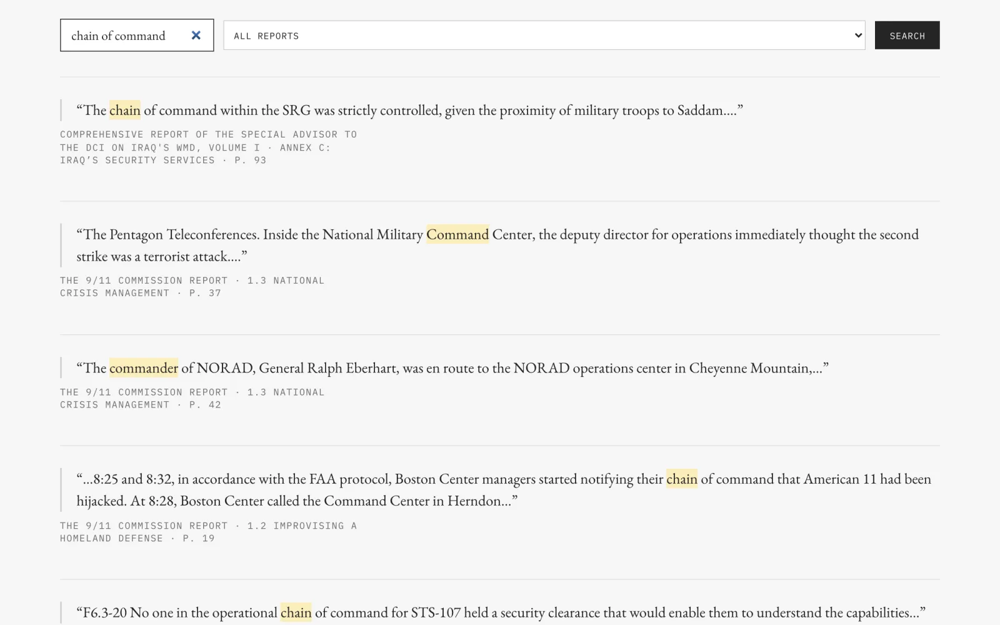
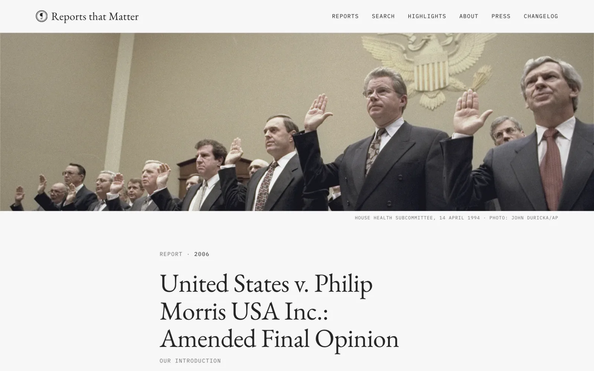

Public inquiries hold the most detailed record we have of what actually happened, and almost nobody reads past the summary. Reports that Matter puts 24 of the big ones online as web pages you can read, search and link to, in the report's own words: the 9/11 Commission, the Senate's financial-crisis report, *United States v. Philip Morris*, Columbia, Chilcot, Leveson, Grenfell, the Post Office Horizon Inquiry and the Covid Inquiry among them, from the UK and the US, 1986 to 2026. Every paragraph has its own link and its page number, and the official PDF is one click from every page.

What these reports hold is the evidence: the companies' own memos, the emails with their time stamps, the morning rebuilt to the minute, gathered by people with the power to compel it. A report gets one news day, built from the executive summary, and then the evidence goes into a PDF on a website that often closes when the inquiry does. Reports that Matter puts it back where it can be read. The site is at [reportsthatmatter.org](https://reportsthatmatter.org); the essay on why it exists is [A treasure trove of facts that matter: why I built Reports that Matter](/blog/why-reports-that-matter).

## What you can do there

- **Read a report whole**, as the inquiry published it, chapter by chapter or on one page, with the page numbers of the printed report in the margin.
- **Search across all of them at once.** One query runs over every report; each result shows the report, the chapter and the page.
- **Link to any sentence.** Every paragraph has its own link. Select any run of words and you get a link to exactly those words, so when you tell someone what a report says, you can show them.
- **Check it against the original.** The official PDF is one click from every paragraph, and where our text and the PDF differ, the PDF is right.
- **Take the text.** Each report's full text is on GitHub as one Markdown file, and every paragraph of every report is a [dataset](/data) you can download: 64,618 rows, each with its page, its paragraph id, a link to the paragraph here and a link to the official document.

## Three passages from the record

*United States v. Philip Morris* (2006), the judgment that found the American cigarette companies had deceived the public for at least 50 years, quotes a Brown & Williamson strategy paper on [p. 1537](https://reportsthatmatter.org/reports/us-v-philip-morris?p=paramount-significance-defendants-internal-documents): "Doubt is our product since it is the best means of competing with the 'body of fact' that exists in the mind of the general public. It is also the means of establishing a controversy." The case was built from the companies' own files, and this is the inside record of how an industry handled science it privately accepted.

The Columbia Accident Investigation Board (2003) reprints the emails NASA's managers and engineers sent one another on 22 January 2003, 10 days before Columbia broke apart on re-entry, as a request to have the shuttle's wing photographed in orbit was raised and then cancelled. On [p. 157](https://reportsthatmatter.org/reports/columbia-accident?p=my-humble-technical-opinion-wrong) it prints one that an engineer, Rodney Rocha, wrote that afternoon and did not send: "In my humble technical opinion, this is the wrong (and bordering on irresponsible) answer from the SSP and Orbiter not to request additional imaging help from any outside source." You get the process, in order, with its times, from the emails; no summary carries it.

The Senate's financial-crisis report (2011) quotes, on [p. 297](https://reportsthatmatter.org/reports/us-psi-financial-crisis?p=times-some-cra-analysts-openly), a Standard & Poor's analyst's email of December 2006 about a security the agency had been asked to rate: "Let's hope we are all wealthy and retired by the time this house of cards falters." And an instant message from April 2007: "[W]e rate every deal[.] [I]t could be structured by cows and we would rate it." The report came out of a two-year investigation with subpoenas, and these are the people inside the rating agency, writing to each other at the time.

## What is in it

24 reports, from the UK and the US, published between 1986 and 2026. In date order: the House Science Committee's Challenger report (1986); the Columbia Accident Investigation Board (2003); the 9/11 Commission (2004); the Duelfer report on Iraq's weapons (2004); *United States v. Philip Morris* (2006); the Stern Review (2006); the Lehman Brothers examiner's report (2010); the Saville Inquiry (2010); the Deepwater Horizon commission (2011); the Senate's financial-crisis report (2011); the Hillsborough Independent Panel (2012); the Leveson Inquiry (2012); the Senate torture report (2014); the Litvinenko Inquiry (2016); the Chilcot Report (2016); the 2017 Intelligence Community Assessment of Russian election interference; the Mueller Report (2019); the January 6th Committee (2022); the Grenfell Tower Inquiry's Phase 2 report (2024); the Jack Smith report (2025); the Post Office Horizon IT Inquiry (2025); the Covid Inquiry's Module 2 report (2025); the Southport Inquiry's Phase 1 report (2026); and the Thirlwall Inquiry (2026).

Some are not whole yet, and each says so at the top: Chilcot is the executive summary, Lehman is Volumes 1 and 3, and several others are their first volume. [All of them are here](/reports), and the appendix to the [essay](/blog/why-reports-that-matter) has a line on each.

Each report opens with a short introduction, labelled as ours: what the inquiry was, why it mattered and where to start reading. Below it is the report.

## Questions

**Who is behind it?** Rufus Pollock, founder of the Open Knowledge Foundation, who started it in 2014 under the name Official Inquiries and picked it up again in 2025. It is built with [Datopian](https://www.datopian.com), the data company he co-founded. The [essay](/blog/why-reports-that-matter) tells the story.

**Is it free?** Yes. No ads, no accounts, no tracking cookies, no paywall.

**Where does the text come from, and is it accurate?** From the official PDF, converted by software and compared against it, page by page. It is not perfect, and we say where: each report's notes list what has been checked and what is still wrong, and the scanned older reports, Challenger above all, have noise in their tables. If you find an error, [tell us](/about#contact) and we will fix it and list the fix.

**Did AI write it?** No language model wrote, summarised or rewrote the report text. AI coding agents built much of the software and the site, under Rufus Pollock's direction, and the code is public. The introductions are ours: drafted with AI help, checked by the editor, and labelled.

**Can I cite it?** Cite the report, as you would from the PDF: its title, year and page, or its paragraph number where the inquiry numbers its paragraphs (UK inquiries usually do). Add the link to the paragraph here, so your reader can see the words in context with the official document one click away. For example: *United States v. Philip Morris* (2006), p. 1537, [reportsthatmatter.org/reports/us-v-philip-morris?p=paramount-significance-defendants-internal-documents](https://reportsthatmatter.org/reports/us-v-philip-morris?p=paramount-significance-defendants-internal-documents). When a correction changes a paragraph's id, the old link redirects to the new one.

**What about licences?** The text keeps the status it has at its source. The US federal reports are public domain; the UK reports are Crown copyright under the Open Government Licence; two (Hillsborough and the Lehman examiner's report) are not under an open licence we can find, and we serve them as public-interest documents with their sources named. What we add, the structure, paragraph ids and introductions, is CC BY 4.0, and the code is open source on [GitHub](https://github.com/reportsthatmatter). The statement for each report is on the [Data page](/data).

**Is the data available?** Yes. Every paragraph of every report, with its page, paragraph id, licence and links, as gzipped CSV or JSON Lines at [/data](/data), and each report's full text as one Markdown file on [GitHub](https://github.com/reportsthatmatter).

**Which reports are next? Can I suggest one?** Next are the later volumes of the reports that are only partly here, and whichever reports people keep asking for. If there is one you need, write to contact@reportsthatmatter.org.

**What if a report is about me?** You can ask us to change or remove anything we made from it (a quote card, a post, a line of our introduction) and we will do it within a day without asking why. The route is on every report's page.

**How do I follow?** The [Bluesky account](https://bsky.app/profile/reportsthatmatter.org) posts one passage a day, verbatim, with its page and link. The [newsletter](/newsletter) is one email a month: a few passages from the archive on one subject, and any new reports. The [changelog](/changelog) records what changed, and this blog has a [feed](/blog/feed.xml).

https://reportsthatmatter.org
