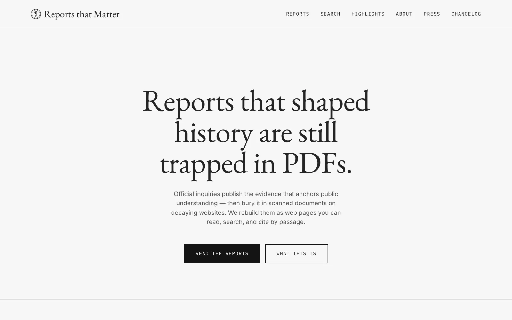
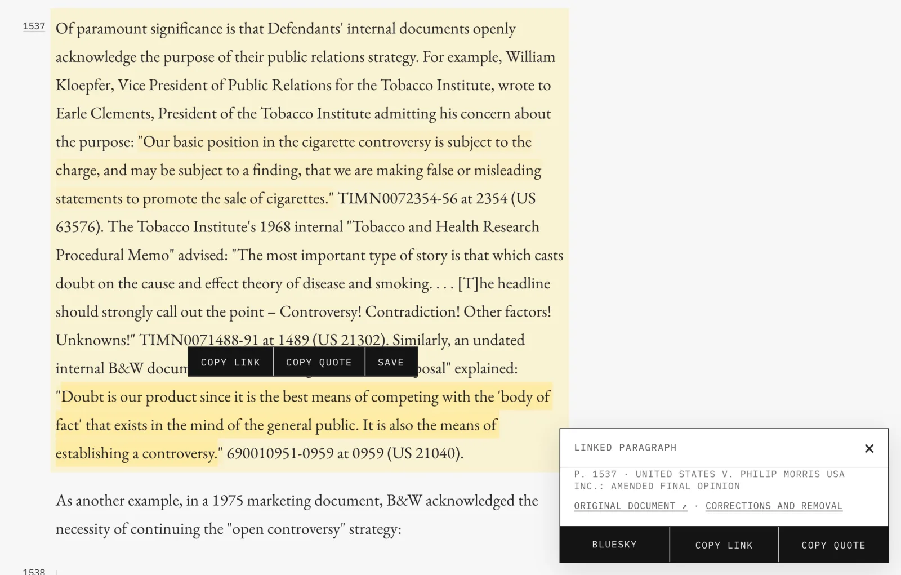
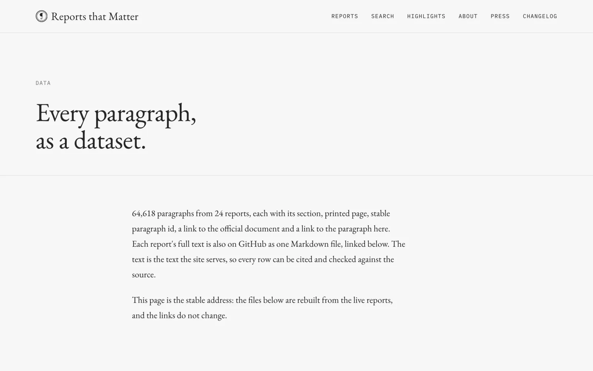

Public inquiries hold the most detailed record we have of what actually happened, and almost nobody reads past the summary. **Reports that Matter puts those reports online**, to read, search and link to, in their own words.

Inquiries can make people hand over **their own memos and emails**. Then the report gets one news day and sinks into a thousand-page PDF, on a website that often vanishes when the inquiry closes.

Go and read: [reportsthatmatter.org](https://reportsthatmatter.org). Why I built it: [A treasure trove of facts that matter](/blog/why-reports-that-matter).

## What you can do there

- **Read a report whole**, with the printed page numbers in the margin.
- **Search every report at once.**
- **Link to any sentence.** Select any words and get a link to exactly those words.
- **Check it against the original.** The official PDF is one click from every paragraph.
- **Take the text.** Every report is on GitHub, and every paragraph is a [downloadable dataset](/data).

## Three passages from the record

### "Doubt is our product"

> Doubt is our product since it is the best means of competing with the 'body of fact' that exists in the mind of the general public. It is also the means of establishing a controversy.

A Brown & Williamson strategy paper, quoted in *United States v. Philip Morris* (2006), the judgment that found the American cigarette companies had deceived the public for at least 50 years. The case was built from the companies' own files. [Read it in place, p. 1537 →](https://reportsthatmatter.org/reports/us-v-philip-morris?p=paramount-significance-defendants-internal-documents)

### "This house of cards"

> Let's hope we are all wealthy and retired by the time this house of cards falters.

A Standard & Poor's analyst, by email in December 2006, about a security the agency had been asked to rate. Four months later, by instant message:

> [I]t could be structured by cows and we would rate it.

From the Senate's 2011 report on the financial crisis. [Read it in place, p. 297 →](https://reportsthatmatter.org/reports/us-psi-financial-crisis?p=times-some-cra-analysts-openly)

### The email he didn't send

On 22 January 2003, ten days before Columbia broke apart on re-entry, a request to photograph the shuttle's wing in orbit was raised and then cancelled. That afternoon an engineer, Rodney Rocha, wrote an email he did not send:

> In my humble technical opinion, this is the wrong (and bordering on irresponsible) answer from the SSP and Orbiter not to request additional imaging help from any outside source.

The Columbia Accident Investigation Board (2003) prints the day's emails in order, with their times. No summary carries that. [Read it in place, p. 157 →](https://reportsthatmatter.org/reports/columbia-accident?p=my-humble-technical-opinion-wrong)

## What is in it

Two dozen of the inquiries that shaped Britain and America: **Chilcot, Mueller, the 9/11 Commission, the Post Office Horizon inquiry, Grenfell** and more. [See them all](/reports). Where a report isn't complete yet, it says so at the top.

Each report opens with a short introduction, labelled as ours: what the inquiry was, why it mattered and where to start reading. Below it is the report.

## Questions

**Who is behind it?** Rufus Pollock, founder of the Open Knowledge Foundation, who started it in 2014 under the name Official Inquiries and picked it up again in 2025. It is built with [Datopian](https://www.datopian.com), the data company he co-founded. The [essay](/blog/why-reports-that-matter) tells the story.

**Is it free?** Yes. No ads, no accounts, no tracking cookies, no paywall.

**Where does the text come from, and is it accurate?** From the official PDF, converted by software and compared against it, page by page. It is not perfect, and we say where: each report's notes list what has been checked and what is still wrong, and the scanned older reports, Challenger above all, have noise in their tables. If you find an error, [tell us](/about#contact) and we will fix it and list the fix.

**Did AI write it?** No language model wrote, summarised or rewrote the report text. AI coding agents built much of the software and the site, under Rufus Pollock's direction, and the code is public. The introductions are ours: drafted with AI help, checked by the editor, and labelled.

**Can I cite it?** Cite the report, as you would from the PDF: its title, year and page, or its paragraph number where the inquiry numbers its paragraphs (UK inquiries usually do). Add the link to the paragraph here, so your reader can see the words in context with the official document one click away. For example: *United States v. Philip Morris* (2006), p. 1537, [reportsthatmatter.org/reports/us-v-philip-morris?p=paramount-significance-defendants-internal-documents](https://reportsthatmatter.org/reports/us-v-philip-morris?p=paramount-significance-defendants-internal-documents). When a correction changes a paragraph's id, the old link redirects to the new one.

**What about licences?** The text keeps the status it has at its source. The US federal reports are public domain; the UK reports are Crown copyright under the Open Government Licence; two (Hillsborough and the Lehman examiner's report) are not under an open licence we can find, and we serve them as public-interest documents with their sources named. What we add, the structure, paragraph ids and introductions, is CC BY 4.0, and the code is open source on [GitHub](https://github.com/reportsthatmatter). The statement for each report is on the [Data page](/data).

**Is the data available?** Yes. Every paragraph of every report, with its page, paragraph id, licence and links, as gzipped CSV or JSON Lines at [/data](/data), and each report's full text as one Markdown file on [GitHub](https://github.com/reportsthatmatter).

**Which reports are next? Can I suggest one?** Next are the later volumes of the reports that are only partly here, and whichever reports people keep asking for. If there is one you need, write to contact@reportsthatmatter.org.

**What if a report is about me?** You can ask us to change or remove anything we made from it (a quote card, a post, a line of our introduction) and we will do it within a day without asking why. The route is on every report's page.

**How do I follow?** The [Bluesky account](https://bsky.app/profile/reportsthatmatter.org) posts one passage a day, verbatim, with its page and link. The [newsletter](/newsletter) is one email a month: a few passages from the archive on one subject, and any new reports. The [changelog](/changelog) records what changed, and this blog has a [feed](/blog/feed.xml).

https://reportsthatmatter.org
